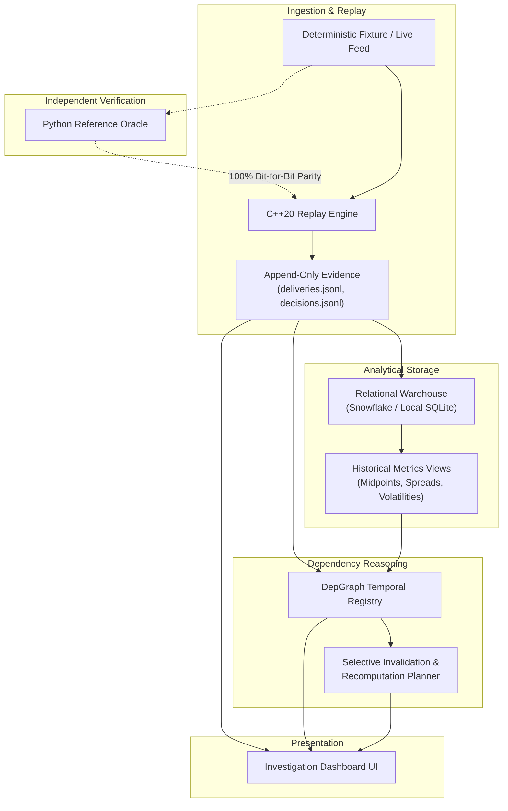

# MarketTrace — Technical Architecture

This document specifies the architectural components, contracts, and data pipelines comprising MarketTrace.

---

## 1. System Context & Data Flow

---

## 2. Core Subsystems

### 2.1 C++20 Order-Book Replay Core (`engine/`)
- **Header Files:** `envelope.hpp`, `order_book.hpp`, `replay.hpp`.
- **Implementation:** `envelope.cpp`, `order_book.cpp`, `replay.cpp`, `main.cpp`.
- **State Representation:**
  - Bids: `std::map<int64_t, int64_t, std::greater<int64_t>>` (descending by price ticks).
  - Asks: `std::map<int64_t, int64_t, std::less<int64_t>>` (ascending by price ticks).
- **Validation Engine:**
  - Enforces positive price ticks and non-negative size units.
  - Size = 0 deletes price level; size > 0 updates or inserts price level.
  - Validates contiguous provider sequence: detects drops (`actual > expected`) and duplicates (`actual <= expected`).
  - Crossed book detection (`best_bid >= best_ask`).

### 2.2 Python Reference Oracle & Generator (`reference/`)
- **`reference/oracle.py`**: Cleanroom Python reference implementation. Computes exact arithmetic for midpoints, spreads, and sample standard deviation rolling volatility across 11 consecutive 1-second sample points (10 log returns, divided by 9 for sample variance).
- **`reference/generator.py`**: Deterministic generator using PRNG seeded with `seed=42`. Generates canonical traces (`clean_run.json`, `faulted_run.json`) and private evaluator manifest (`evaluator_manifest.json`).

### 2.3 Relational Analytical Warehouse (`warehouse/`)
- **DDL & SQL:** `schema.sql`, `load.sql`, `teardown.sql`, `analytics.sql`.
- **Local SQLite Runner (`local_warehouse.py`):** Replicates Snowflake table schemas, staging, and windowed analytics locally to guarantee 100% offline verification.
- **Snowflake Runner (`snowflake_runner.py`):** Bounded runner configured for X-Small warehouse with auto-suspend and strict quota limits.

### 2.4 DepGraph Temporal Registry (`depgraph/`)
- **`registry.py`**: Node kinds (`RAW_DELIVERY`, `ORDER_BOOK`, `BEST_QUOTES`, `MIDPOINT_SPREAD`, `LOG_RETURNS`, `ROLLING_VOLATILITY`). Includes cycle detection and topological sorting.
- **`impact_analyzer.py`**:
  - Propagates invalidation down the dependency tree.
  - Verifies unaffected sets remain intact.
  - Enforces honest recovery: fresh snapshot restores current book, leaving historical gap incomplete.
  - Plans minimal topological recomputation (Revision 2) when withheld historical data is restored.

### 2.5 Investigation Dashboard (`app/`)
- Local HTTP REST server (`app/server.py`) with 3 views:
  1. **Run Overview:** Current market state, metrics, data mode badge, engine status.
  2. **Incident Investigation:** Event arrival timeline, raw JSON envelope, decision inspector, DepGraph breadcrumb path.
  3. **Recovery Comparison:** Side-by-side comparison of Clean Reference vs Damaged State vs Controlled Recovery.
