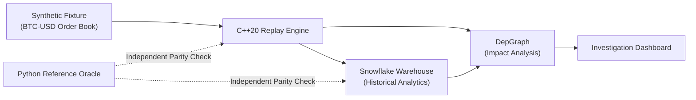

# MarketTrace

[](https://en.wikipedia.org/wiki/C%2B%2B20)
[](https://www.python.org/)
[](LICENSE)

> A deterministic BTC-USD order-book fault replay and impact verification system. When an incoming market-data stream is interrupted or corrupted, MarketTrace reconstructs trustworthy state and identifies precisely which downstream analytics require recalculation.

---

## The Problem

Market data streams are vulnerable to network packet drops, sequence gaps, corrupted prices, and duplicate arrivals. In real-time market analysis, an unnoticed data gap can silently corrupt downstream rolling metrics (such as midpoints, spreads, and rolling volatilities).

Standard systems either silently forward-fill bad data or discard state entirely. **MarketTrace** explores a disciplined alternative:
1. Detect corruptions or gaps immediately using sequence and boundary validation rules.
2. Maintain explicit state validity (`VALID`, `STALE`, `INCOMPLETE`, `BLOCKED`).
3. Differentiate between restoring the *current* book state (via a fresh authoritative snapshot) versus repairing *historical* calculation windows (which remain incomplete unless the missing historical evidence is independently restored).
4. Trace downstream analytical dependencies using an adapted dependency graph to selectively recompute only the affected calculation windows.

---

## Architecture Overview



### Components

- **C++20 Replay Engine (`engine/`)**: High-performance, integer-scaled order book maintaining bid/ask levels, sequence tracking, and decision logging.
- **Python Reference Oracle (`reference/`)**: Independent reference model and deterministic test fixture generator for bit-for-bit parity testing.
- **Snowflake Analytical Warehouse (`warehouse/`)**: Batch storage and SQL analytics for historical midpoint, spread, and rolling volatility metrics.
- **DepGraph (`depgraph/`)**: Adapted from Vishnu Padyala's prior [DepGraph project](https://github.com/VISHNU07202003/DepGraph), extended with temporal calculation windows and selective recomputation planning.
- **Investigation Dashboard (`app/`)**: Three interactive views (Run Overview, Incident Investigation, Recovery Comparison).

---

## Project Status

- **Phase 0 (Audit & Scaffold)**: **COMPLETE & PASS**
  - Toolchain verified (`g++ 10.3.0`, `CMake 4.4.4`, `Python 3.12.10`, `pytest 8.3.4`).
  - Shared event envelope, quality states, and decision codes implemented in C++ and Python.
  - Initial C++ contract tests and Python unit tests passing.
- **Phase 1 (Offline Reference & Fixtures)**: Up next.

---

## Offline Quickstart

No credentials or cloud resources are needed to build and run the offline engine and test suites.

### Prerequisites
- C++20 compliant compiler (GCC 10+, Clang 11+, or MSVC 2019+)
- CMake 3.20+
- Python 3.10+

### Build & Run C++ Engine

```powershell
# Configure CMake
cmake -B build -G "MinGW Makefiles"

# Build all targets
cmake --build build

# Run unit tests
ctest --test-dir build --output-on-failure

# Run CLI entry point
./build/markettrace_cli.exe
```

### Run Python Reference Tests

```powershell
python -m pytest reference/tests/
```

---

## Relationship to DepGraph

This project builds on the concept of dependency graph reasoning introduced in Vishnu Padyala's [DepGraph repository](https://github.com/VISHNU07202003/DepGraph). The original DepGraph inferred static schema-level producer-to-consumer field linkages from tool catalogs. 

MarketTrace adapts this paradigm to dynamic, temporal market data:
- Nodes represent analytical states (`OrderBook` → `BestBidAsk` → `MidpointSpread` → `LogReturns` → `RollingVolatility`).
- Edges represent temporal dependency windows.
- Invalidation cascades flag only the precise time windows affected by missing or rejected deliveries.

---

## Non-Goals & Honest Limits

- **Not an HFT or trading execution system**: MarketTrace does not submit orders, predict alpha, or target microsecond execution.
- **Honest recovery**: Fresh snapshots restore current quote validity, but historical gaps remain `INCOMPLETE` unless authentic historical data is replayed.
- **Controlled experiments**: Cloud experiments use minimal, auto-suspending Snowflake warehouses within a bounded trial budget.
