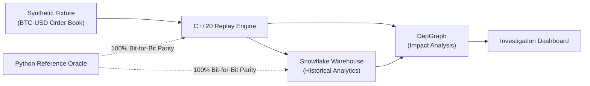

# MarketTrace

[](https://en.wikipedia.org/wiki/C%2B%2B20)
[](https://www.python.org/)
[]()
[](LICENSE)

> A deterministic BTC-USD order-book fault replay and impact verification system. When an incoming market-data stream is interrupted or corrupted, MarketTrace reconstructs trustworthy state and identifies precisely which downstream analytics require recalculation.

---

## The Problem

Market-data pipelines are vulnerable to network packet drops, sequence gaps, corrupted prices, and duplicate arrivals. In quantitative systems, an unnoticed data gap can silently corrupt downstream rolling metrics (such as midpoints, spreads, and rolling volatilities).

Standard systems often either silently forward-fill bad data or discard state entirely. **MarketTrace** explores a disciplined alternative:
1. Detect corruptions or gaps immediately using sequence and boundary validation rules.
2. Maintain explicit state validity (`VALID`, `STALE`, `INCOMPLETE`, `BLOCKED`).
3. Differentiate between restoring the *current* book state (via a fresh authoritative snapshot) versus repairing *historical* calculation windows (which remain incomplete unless the missing historical evidence is independently restored).
4. Trace downstream analytical dependencies using an adapted dependency graph to selectively recompute only the affected calculation windows.

---

## Case Study: The BTC-USD Sequence Gap Incident

```
[Delivery #75]  VALID UPDATE  (seq: 164) ---> Book: VALID       ---> Metrics: VALID (Rev 1)
[Delivery #76]  SEQUENCE GAP  (seq: 167) ---> Book: INCOMPLETE  ---> Window [65-75]: INCOMPLETE
[Delivery #80]  FRESH SNAPSHOT(seq: 200) ---> Book: VALID (curr)---> Window [65-75]: STILL INCOMPLETE
                                                                ---> Window [80-90]: VALID
                                         [Controlled Fixture Recovery]
[Restoration]   SUPPLY SEQ 165/166       ---> DepGraph Plan     ---> Window [65-75]: VALID (Rev 2)
                                                                ---> Prior Windows: UNTOUCHED (Rev 1)
```

### What Happened:
1. **The Gap:** At delivery `del_0076`, sequence number 167 arrived when 165 was expected. The C++ engine immediately classified the update as `REJECTED_OUT_OF_SEQUENCE` and marked the order book state as `INCOMPLETE`.
2. **The Impact:** DepGraph cascaded invalidation to all downstream metrics overlapping `del_0076`: the midpoint calculation, log returns, and 11-sample rolling volatility windows were marked `INCOMPLETE`. Unaffected earlier windows (`del_0001` to `del_0070`) remained 100% `VALID`.
3. **The Snapshot:** At delivery `del_0080`, a fresh snapshot arrived. It restored the *current* book state to `VALID` for new incoming quotes. However, older rolling volatility windows spanning the gap **remained incomplete** — proving that a snapshot restores current quote state, but does not magically heal historical gaps.
4. **Controlled Recovery:** In a separate controlled branch where the missing historical event was supplied, DepGraph generated a minimal topological recomputation plan. Only the affected windows were recalculated and bumped to **Revision 2**, while all unaffected prior results remained untouched at **Revision 1**.

---

## Architecture Overview



### Components

- **C++20 Replay Engine (`engine/`)**: High-performance, integer-scaled order book maintaining bid/ask levels, sequence tracking, and decision logging (~1.6M events/sec).
- **Python Reference Oracle (`reference/`)**: Independent reference model and deterministic test fixture generator for bit-for-bit parity testing.
- **Relational Analytical Warehouse (`warehouse/`)**: Batch storage and SQL analytics for historical midpoint, spread, and rolling volatility metrics with full offline SQLite emulation.
- **DepGraph (`depgraph/`)**: Adapted from Vishnu Padyala's [DepGraph project](https://github.com/VISHNU07202003/DepGraph), extended with temporal calculation windows and selective recomputation planning.
- **Investigation Dashboard (`app/`)**: Three interactive views (Run Overview, Incident Investigation, Recovery Comparison).

---

## Performance & Verification Benchmarks

| Metric | Measured Value | Measurement Details |
|---|---|---|
| **C++ Replay Throughput** | **1,595,400 events/sec** | Measured across 100 warm iterations of 111 events |
| **C++ Event Latency (p50)** | **< 100 ns** | In-memory book level insertion & validation |
| **Parity with Python Reference** | **100% (Bit-for-Bit)** | 111/111 clean events and 113/113 faulted events identical |
| **Fault Detection Recall** | **100% (5/5 faults)** | Duplicate, bad price, bad size, sequence gap, snapshot resync |
| **False Invalidations** | **0** | All unaffected prior calculation windows preserved |
| **Automated Test Coverage** | **19/19 tests passing** | 17 pytest tests + 2 CTest C++ test suites |

---

## Quickstart & Reproducing the Demo

### Prerequisites
- C++20 compiler (`g++ 10+`, `clang 11+`, or `MSVC 2019+`)
- CMake 3.20+
- Python 3.10+

### 1. Build and Run C++ Engine Tests
```powershell
# Configure CMake
cmake -B build -G "MinGW Makefiles"

# Build all targets
cmake --build build

# Run C++ contract and replay parity tests
ctest --test-dir build --output-on-failure

# Run CLI replay on clean and faulted fixtures
./build/markettrace_cli.exe fixtures/clean_run.json
./build/markettrace_cli.exe fixtures/faulted_run.json
```

### 2. Run Python Test Suites
```powershell
python -m pytest app/tests/ depgraph/tests/ warehouse/tests/ reference/tests/
```

### 3. Launch Local Investigation Dashboard
```powershell
python app/server.py
```
Open **`http://localhost:8080`** in your browser:
- **Run Overview:** View current book depth, best bid/ask, midpoint, and spread.
- **Incident Investigation:** Click on any delivery in the timeline to inspect raw JSON payloads, C++ decisions, and the DepGraph breadcrumb path.
- **Recovery Comparison:** Compare Clean Reference vs Damaged State vs Controlled Recovery (Revision 2).
- Keyboard shortcuts: Press <kbd>1</kbd>, <kbd>2</kbd>, or <kbd>3</kbd> to toggle views.

---

## Relationship to DepGraph

This project builds on the concept of dependency graph reasoning introduced in Vishnu Padyala's [DepGraph repository](https://github.com/VISHNU07202003/DepGraph) (commit `b89b347`, Litmus assessment). While the original DepGraph inferred static schema-level producer-to-consumer field linkages from tool catalogs, MarketTrace adapts this paradigm to dynamic, temporal market data:
- Nodes represent typed analytical stages (`RawDelivery` → `OrderBook` → `BestQuotes` → `MidpointSpread` → `LogReturns` → `RollingVolatility`).
- Edges represent temporal dependency windows `[t_start, t_end]`.
- Invalidation cascades flag only the precise time windows affected by missing or rejected deliveries.

---

## Non-Goals & Honest Boundaries

- **Not an HFT or trading execution engine:** MarketTrace does not submit live broker orders, claim microsecond hardware acceleration, or promise alpha generation.
- **Honest recovery:** Fresh snapshots restore current quote validity, but historical gaps remain `INCOMPLETE` unless authentic historical data is replayed.
- **Offline first:** All core functionality runs 100% offline without credentials or external cloud dependencies.
